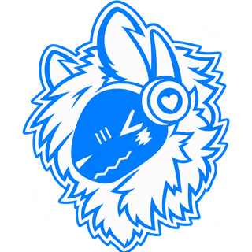

<div align="center">



# Good Boy

**One Discord bot instead of ten.** Moderation, tickets, levels, an economy, games, music and more, in modules you
switch on per server. You run it yourself, so your community's data stays with you.

[](https://github.com/jamiechastain10-blip/Good-Boy-Bot/releases/latest/download/Good-Boy-Setup.exe)

[](https://github.com/jamiechastain10-blip/Good-Boy-Bot/releases/latest/download/Good-Boy-Portable.exe)
[-555555?style=flat-square&logo=apple&logoColor=white)](https://github.com/jamiechastain10-blip/Good-Boy-Bot/releases/latest/download/Good-Boy-Mac.dmg)
[](https://github.com/jamiechastain10-blip/Good-Boy-Bot/releases/latest/download/Good-Boy-Android.apk)
[](https://github.com/jamiechastain10-blip/Good-Boy-Bot/releases/latest)

[Features](#what-it-does) · [Get started](#get-started) · [All modules](#every-module) · [Keep it online](#keep-it-online) · [Help](#troubleshooting) · [Changelog](CHANGELOG.md)

</div>

---

## Why Good Boy

- **Replaces the usual bot stack.** What servers normally get from Dyno, Carl-bot, MEE6, Ticket Tool, Statbot, a music bot,
  a marriage bot and a game bot, in one bot with one dashboard.
- **Free, with nothing locked.** No premium tier, no paid features, no coins for real money.
- **Your data stays yours.** The bot runs on your computer or your own server. There is no central Good Boy database to
  leak, and member IP addresses are never stored.
- **Easy to set up.** The Windows app does everything with buttons. In Discord, commands open forms with dropdowns and
  pickers instead of making you type options.
- **A dashboard and phone app.** Settings, moderation, tickets and live charts from a browser or your phone.

## What it does

| | |
|---|---|
| 🛡️ **Moderation** | Warn, timeout, kick, ban (also temporary), case history, warnings that escalate to kick or ban, full logs |
| 🤖 **AutoMod** | Scam and phishing links (on by default), spam, bad words, links and invites, mass mentions, caps, emoji, repeats; raid protection and anti-nuke |
| ✅ **Verification** | A verify button, optional picture captcha, welcome and goodbye messages with images |
| 🎫 **Tickets** | Categories with forms, claiming, priorities, staff-only notes, transcripts and archive, staff applications, 1-5 star ratings |
| 📬 **Modmail** | Members DM the bot; staff answer from a private thread |
| ⭐ **Levels** | Text, voice and reaction XP, XP boosts, level roles, rank cards members can style, live leaderboards |
| 🎭 **Roles** | Role menus with limits, required roles and timed roles; reaction roles, auto roles, game roles |
| 💰 **Economy** | Daily streaks, a shop with roles and items, `/work`, `/bank` with interest, pets, a weekly lottery, optional `/rob` |
| 🎮 **Games** | Slots, blackjack, coin flip, Tower, Wires, Bingo, Memory, Hangman, Trivia, Pong, and a deep fishing game |
| 🐾 **Critters** | Good Boy's own collecting game: critters appear while people chat; catch, trade and battle them |
| 💞 **Social** | Marriage and family trees, 20 roleplay actions, `/fun`, counting and word chain |
| 🎉 **Engagement** | Giveaways, polls, suggestions, starboard, scheduled and repeating announcements, dead-chat pings |
| 🎵 **Music** | A shared player with a queue; uploads, radio and audio links; with the owner's opt-in, YouTube, Spotify (songs and playlists), SoundCloud and BandLab |
| 🔊 **Voice** | Text-to-speech and a no-mic channel read aloud; join-to-create voice rooms |
| 📡 **Feeds** | YouTube, Twitch, Kick, Bluesky, Mastodon, Reddit, RSS, GitHub and Minecraft server status |
| 📊 **Stats** | Message and voice stats, counter channels, invite tracking, achievements, weekly recaps |
| 💾 **Backups** | Weekly snapshots of roles, channels and permissions; restore only adds back what's missing |
| 🧰 **Extras** | Custom commands with variables, sticky messages, `/say`, highlights, right-click Translate, image quotes, clips, reminders |

**Your own art.** The bot owner can replace any roleplay GIF or critter picture with their own (`/art`, or drop files in a folder): [`docs/CUSTOM-ART.md`](docs/CUSTOM-ART.md).

**Switching from another bot?** `/migrate scan` finds what Carl-bot, YAGPDB, Statbot or TTS Bot left behind (reaction
roles, logs, starboard, welcome, join roles, custom commands) and offers to set it up. See
[`docs/REPLACING-OTHER-BOTS.md`](docs/REPLACING-OTHER-BOTS.md).

---

## Get started

### The easy way: the Windows app
1. Download the **installer** (the big button above) and run it.
2. Follow the setup. It walks you through making your bot on Discord, pasting its token, and inviting it to your server.
3. That's it. The app starts the bot, shows the dashboard, and updates itself when a new version comes out.

The portable `.exe` runs without installing (it tells you about updates instead of installing them). The Mac app isn't
signed yet: right-click it and choose **Open** the first time.

### From the code
You need [Node.js](https://nodejs.org) **22.13 or newer**.

1. **Make the bot on Discord.** Go to the [Developer Portal](https://discord.com/developers/applications) and choose
   **New Application**. Then open the **Bot** tab, press **Reset Token** and copy the token. On the same page, turn on all
   three **Privileged Gateway Intents** (Server Members, Message Content, Presence) and save.
2. **Install and start.** Open a terminal in this folder:
   ```
   npm install
   npm run setup
   npm start
   ```
   `npm run setup` asks for your token, saves it in `.env` and prints your invite link.
3. **Invite it** with that link (or `npm run invite`). Then, in Server Settings → Roles, **drag the bot's role near the
   top**: Discord only lets a bot manage roles and members below its own role.
4. **Turn things on** in Discord with `/modules`. Nothing is on until you turn it on, and each server has its own settings.
   Want a channel left alone (no critters or coin drops in your arcade channel, say)? Run `/channel` there and pick what stays quiet.

`npm run check` tests your setup (Node, packages, token and intents). `/health` in Discord shows what's working.

### The dashboard
A control panel in your browser at <http://localhost:3000>. To sign in to it, copy the **Client Secret** from your app's
**OAuth2** page in the Developer Portal, add `http://localhost:3000/callback` under **Redirects**, and put
`DISCORD_CLIENT_SECRET=...` in `.env` (or run `npm run setup` again). In the Windows app it's built in and signed in
already.

- **Admins** see everything. **Moderators** get a limited view once their role has the `dashboard.access` permission.
  They only see the pages they also have permission for, and the bot checks this on every request.
- To open it from your phone or another computer, the Windows app's **Settings → Dashboard link** sets up a free https
  link with Tailscale in one click. Already use Tailscale Funnel, or have your own address? The app supports both. Other
  ways: [`docs/HOSTING.md`](docs/HOSTING.md).
- The [**Good Boy hub**](https://goodboyhub.pages.dev) lists every server you manage across Good Boy bots, in one place.

### Quick recipes

| Goal | Do this |
|---|---|
| Mod log and AutoMod | `/modules` → moderation → Turn on → Edit settings → pick a log channel → `/automod status` |
| Welcome messages | `/modules` → member-management → Turn on → Edit settings → welcome on and a channel |
| Verification | turn on member-management → `/verify setup` (optional: switch on Captcha in its settings) |
| Tickets | turn on support → set the staff role, ticket category and log channel → `/ticket panel` |
| Staff applications | `/ticket type add label:"Mod application" application:true role:@Moderator` → `/ticket panel` |
| Modmail | turn on modmail → pick the staff channel in its settings; members just DM the bot |
| Level roles | turn on community → `/levels reward add` |
| Self-service roles | turn on roles → `/rolemenu create` |
| Let moderators use the dashboard | `/permissions allow permission:dashboard.access role:@Moderators` |

---

## Every module

<details>
<summary><b>Show all modules and their commands</b></summary>

| Module | What it does |
|---|---|
| **moderation** | `/warn` `/timeout` `/untimeout` `/kick` `/ban` (with an optional duration) `/unban` `/purge` `/modhistory` · AutoMod (`/automod status\|rule\|exempt\|recent\|word\|domain`) with a scam-link filter, presets and per-rule actions · warnings that escalate to timeout, kick or ban · raid protection · anti-nuke · message, member, role and voice logs |
| **member-management** | `/verify setup\|panel\|repost\|status\|reset` with an optional captcha · welcome and goodbye messages with images · `/profile` (members' own name and colour role) · `/introduce` · `/birthday` · `/afk` · roles given back to members who return |
| **roles** | `/rolemenu create\|limits\|delete` (most roles at once, a required role, roles that expire) · `/reactionrole` · `/autorole` · `/gamerole` |
| **support** | Tickets with 8 built-in categories plus your own types, forms with member pickers and uploads, urgency, claiming, required close notes, transcripts and a searchable archive, a staff-only watch log, ban appeals, staff applications with an optional role, 1-5 star ratings · `/ticket …` |
| **support-html-transcripts** | add-on: styled HTML transcripts |
| **modmail** | members DM the bot; a private staff thread opens; `//` lines are staff notes; Close and Block buttons |
| **community** | `/rank` (a picture card members can style) `/leaderboard` `/liveboard` `/rep` `/serverstats` `/levels reward` · `/xp set\|reset\|ignore\|boost` · voice and reaction XP |
| **engagement** | `/announce send\|schedule` (repeating every 1-12 hours, daily or weekly) · `/poll` · `/suggest` · `/starboard` |
| **economy** | `/balance` `/daily` `/pay` `/top` `/shop` `/work` `/bank` `/pet` `/rob` (off by default) `/economy-admin` · starter shop items (lucky charm, work boost, pet treat, lottery tickets) · coin events in chat |
| **games** | `/slots` `/blackjack` `/coinflip` `/fish` `/arcade` (Tower, Wires, Bingo, Memory, Hangman, Trivia, Pong) · fishing: 24 places, 2,000 fish, levels to 4,000, rods with perks and ★ upgrades, earned rods, daily and weekly challenges · [Fishing Wiki](docs/FISHING-WIKI.md) |
| **critters** | 52 original critters appear while people chat · `/critters list\|info\|dex\|buddy\|rename\|trade\|battle\|release` · staff: `here`, `spawn` |
| **family** | `/marry` · `/family tree\|info\|adopt\|divorce\|disown\|leave` with a family tree picture |
| **roleplay** | `/rp` with 20 actions, Good Boy's own animations or Tenor GIFs, "do it back" button |
| **fun** | `/fun 8ball\|dice\|ship\|topic` |
| **counting** | counting channels and word chain · `/counting here\|words-here\|stats\|reset` |
| **giveaways** | `/giveaway start\|end\|reroll\|list` · Enter button, required role, coin prizes paid automatically |
| **music** | `/music` posts a shared player · queue (play next, remove, shuffle, repeat) · uploads, audio links, radio, Jamendo · opt-in media links (YouTube, Spotify songs and playlists, SoundCloud, BandLab and more) |
| **voice** | `/tts …` text-to-speech · a no-mic channel read aloud |
| **tempvoice** | `/voicehub` join-to-create rooms · `/room name\|limit\|privacy\|invite\|permit\|kick\|ban\|transfer\|claim\|info` |
| **partyfinder** | `/party create\|list\|close\|kick` · Join and Leave buttons, spots, start time, optional voice room |
| **integrations** | `/feed add\|remove\|list\|check` (RSS, YouTube, GitHub, Reddit, Twitch, Kick, Bluesky, Mastodon) · `/minecraft` · `/webhook` |
| **invites** | who invited whom, who stayed, new accounts flagged · `/invites user\|top` |
| **stats** | `/stats member\|me\|server\|top\|recap\|backfill\|inactive` · right-click → Message stats · `/counter` channels · activity charts |
| **achievements** | 17 built-in achievements plus your own · `/achievements …` |
| **eclipseid** | `/id` member cards with linked game accounts and privacy per field |
| **tags** | custom commands and auto-replies with `{random}`, `{number}`, `{if}` and `{arg1}` · `/tags add\|list\|use\|remove` |
| **messages** | `/say send\|edit` · `/sticky set\|remove\|list` |
| **utility** | `/highlight` (a DM when someone says your word) · right-click → Apps → Translate |
| **quotes** | right-click → Apps → Quote Image, or `/quote` (animated for animated avatars) |
| **clips** | a clips channel with votes, Best clips, clip of the week |
| **reminders** | `/remind me\|team\|list\|cancel` |
| **botnews** | posts each bot update's notes to an admin channel and the members' part to announcements |
| **deadchat** | pings an opt-in role with a conversation starter when a channel goes quiet |
| **backup** | `/backup create\|list\|restore\|download` · weekly automatic backups |

Always available: `/modules` `/module` `/config` `/channel` (what stays quiet in a channel) `/permissions` `/notifications` `/health` `/help`.

</details>

---

## Keep it online

The bot is online while the computer running it is on. For a server that should never go quiet, run it on a machine that
stays on: a Raspberry Pi, a small cloud server, or a spare computer.

```
bash deploy/install-linux.sh
```

That one command sets up Raspberry Pi OS, Ubuntu or Debian: Node, the bot, your token, and a service that starts the bot
at boot and restarts it after a crash. It can also load your data exported from the Windows app. Docker works too
(`docker compose up -d`). Step by step, with costs: [`docs/ALWAYS-ONLINE.md`](docs/ALWAYS-ONLINE.md).

**One bot, many servers.** Invite the same bot to more servers and each one keeps its own settings and data.

**Updating.** The Windows app updates itself. From the code: replace the files (keep `.env` and `data/`), run
`npm install`, and restart. The database upgrades itself and makes a backup first. `npm run supervised` can also install
signed updates with automatic rollback ([`docs/UPDATES.md`](docs/UPDATES.md)).

---

## Privacy and security

- **Your data stays on your machine.** Everything lives in one file, `data/eclipse.db`. Each server's data is kept apart.
- **Nothing is sold, and there are no trackers.** Message text is only kept where a feature exists to keep it (tickets,
  suggestions, your own announcements, an optional 7-day message log for edits and deletes).
- **Member IP addresses are never stored.**
- **Secrets** stay in `.env` (never commit it) or encrypted in the Windows app.
- **Permissions are checked by the bot itself,** with role order respected, so a moderator can't act on someone above
  them. Roles with dangerous permissions can't be handed out through menus, rewards or auto-roles.
- **The dashboard checks your rights with Discord on every request,** and every settings or permission change goes into
  the security log.
- **Protect your bot token like a password.** Whoever has it controls the bot. Use two-factor login on your Discord
  account, and reset the token in the Developer Portal if it ever leaks.

The dashboard serves `/terms` and `/privacy` pages you can give Discord (set `LEGAL_OPERATOR` and `LEGAL_CONTACT` in
`.env`).

---

## Troubleshooting

**The Windows app is blank or won't update.** Download the [installer](https://github.com/jamiechastain10-blip/Good-Boy-Bot/releases/latest/download/Good-Boy-Setup.exe)
again and run it. Your bot, settings and data stay. **Ctrl+R** reloads the window. The app keeps a log at
`%APPDATA%\Good Boy\app.log`; send it with any bug report.

**A feature says something is missing.** Run `/health` in Discord or `npm run check`. Most problems are an intent turned
off in the Developer Portal, or the bot's role sitting below the roles it needs to manage.

**The dashboard won't sign in.** Open `/auth/diagnose` on the dashboard address. It checks the Client Secret and the
redirect address.

**Music links don't play.** Links straight to an audio file always work. YouTube, Spotify, BandLab and similar sites only
work after the bot owner turns on **Media links** with `/music` (once per server).

**Pings don't work in announcements or reminders.** The bot needs the "Mention @everyone, @here and All Roles"
permission.

---

## Good to know

- **Modules are trusted code.** They run inside the bot with full access, so only add modules you wrote or trust.
- **Big communities:** Good Boy is one program on one computer, which is plenty for one large server and for many
  smaller ones. Discord asks bots in 100+ servers to be verified before they can use the privileged intents.
- **Text-to-speech** uses Google's public text-to-speech service, or offline voices on Windows.
- **Tested** with an automated suite of over 450 tests against a simulated Discord, plus every Windows build being
  started and checked by GitHub before it's released.

**For developers:** each feature is a folder in `modules/`. How modules work and how to write your own:
[`docs/MODULES.md`](docs/MODULES.md). Design notes: [`docs/ARCHITECTURE.md`](docs/ARCHITECTURE.md). Every change:
[`CHANGELOG.md`](CHANGELOG.md). Older versions are on the [releases page](https://github.com/jamiechastain10-blip/Good-Boy-Bot/releases).

---

<div align="center">

© 2026 Basic Ghost Labs. All rights reserved. · Good Boy

</div>
